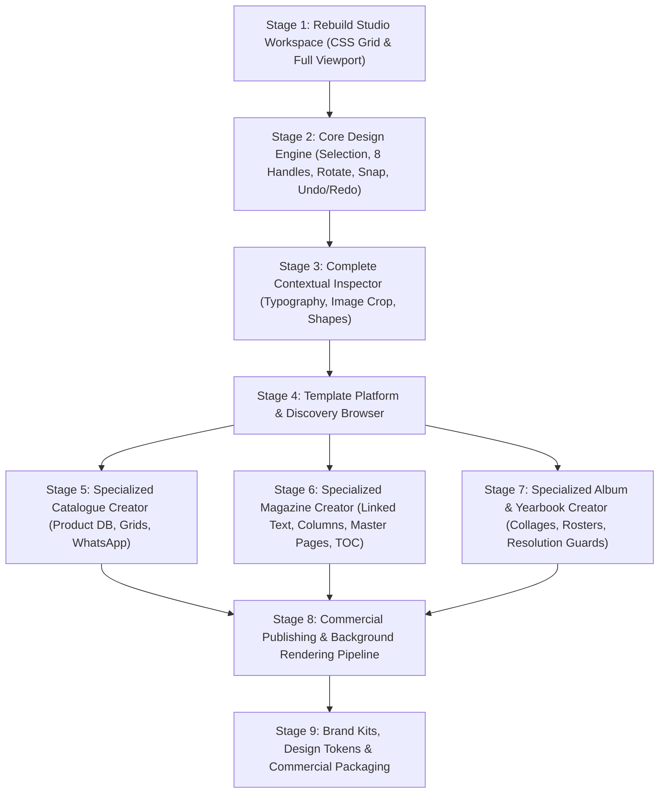

# Flipex Studio — Commercial Product Upgrade & Architecture Plan

> **Document Version:** 2.0.0  
> **Target System:** Nuvis Flipex Visual Document Authoring Engine (`Flipex Studio`)  
> **Status:** Active Master Specification & Phased Roadmap  
> **Based on:** *Flipex Studio — Commercial Product Upgrade Plan* Specification & Technical Review

---

## 1. Executive Summary & Commercial Vision

Flipex Studio is evolving from an early visual editor prototype into a **commercial-grade, browser-based desktop publishing and design suite** built specifically for interactive catalogues, editorial magazines, yearbooks, keepsake albums, and commercial lookbooks.

### The Ultimate Commercial Goal
A user can log into Nuvis Flipex, pick a commercial starter template or start from a blank canvas, design a multi-page publication with pixel-perfect typography and rich media, save reliably with background autosave and version history, export high-resolution vector print PDFs (300 DPI, bleed & safe margins), and compile directly into an interactive, responsive flipbook reader with 1-tap WhatsApp commerce hotspots — **without requiring Canva, Adobe InDesign, or external design software**.

---

## 2. Technical Audit & Architectural Diagnosis

Based on comprehensive inspection of the codebase (`frontend/src/pages/FlipexStudio.tsx`, `frontend/src/components/ProtectedRoute.tsx`, `backend/src/Controllers/StudioController.php`, and database schemas), the following critical foundational gaps must be addressed:

| Area | Current Implementation | Commercial Requirement | Priority |
| :--- | :--- | :--- | :--- |
| **Document State & Persistence** | `handleSavePage()` saves only the active page. Edits across pages can be lost on navigation or refresh. | Document-level atomic saving, revision tracking, dirty-state debounced autosave, and local recovery. | **Critical (P0)** |
| **Object Transformation** | Basic absolute-positioned `div`s with custom `mousedown` translate only. | Complete selection bounding box, 8 resize handles (proportional & directional), rotation handle, multi-select, and alignment snap. | **Critical (P0)** |
| **Component Architecture** | Monolithic 3,000+ line `FlipexStudio.tsx` mixing canvas, UI, modals, state, and API. | Modular architecture under `frontend/src/studio/` (`core/`, `canvas/`, `elements/`, `inspector/`, `toolbar/`). | **High (P1)** |
| **Publishing Pipeline** | Flipbooks are published by extracting element image URLs; does not render full composite page design. | Unified rendering pipeline: canonical document model rendered identically to canvas preview, print PDF, and flipbook page WebP/PNG images. | **Critical (P0)** |
| **Typography & Text Engine** | Basic `<textarea>` and monolithic styling. | Rich-text engine with inline formatting, headings, paragraphs, drop caps, web-fonts, and linked text frames across pages. | **High (P1)** |
| **Template Management** | Static backend seed array. | Full template creation workflow, customizable placeholders (text, image, product, logo), category browsing, and marketplace. | **High (P1)** |
| **Undo / Redo & History** | None. Canvas actions are immediately committed without reversal. | Command-pattern or snapshot-based Undo/Redo stack (`Ctrl+Z`, `Ctrl+Shift+Z`) for all canvas mutations. | **High (P1)** |
| **Layer Management** | Basic z-index +/- buttons. | Dedicated Layers panel: reorder, rename, hide/show, lock/unlock, group/ungroup, and nested hierarchies. | **Medium (P2)** |

---

## 3. Modular Frontend Architecture (`frontend/src/studio/`)

The monolithic `FlipexStudio.tsx` will be restructured into clean, testable, decoupled modules:

```
frontend/src/studio/
│
├── core/                         # Headless design engine & document model
│   ├── DocumentModel.ts          # Canonical schemaVersion 2 document definition
│   ├── PageModel.ts              # Page definitions, background schemas, dimensions
│   ├── ElementModel.ts           # Discriminated union of all element types & props
│   ├── EditorStore.ts            # Reactive editor state (active doc, zoom, selection)
│   ├── SelectionManager.ts       # Single & multi-element selection, rubberband select
│   ├── HistoryManager.ts         # Undo/Redo operation stack (max 50 states)
│   ├── ClipboardManager.ts       # Copy, cut, paste, duplicate across pages
│   ├── SnapManager.ts            # Magnetic grid & smart alignment guide calculations
│   └── CoordinateSystem.ts       # Screen pixels <-> document points (pt) transformations
│
├── canvas/                       # Interactive canvas viewport & renderers
│   ├── StudioCanvas.tsx          # Main canvas viewport wrapper
│   ├── CanvasViewport.tsx        # Scrollable, centered infinite board container
│   ├── CanvasRenderer.tsx        # Document page compositor
│   ├── ElementRenderer.tsx       # Polymorphic element dispatcher
│   ├── SelectionOverlay.tsx      # Bounding box outline, dimensions badge
│   ├── ResizeHandles.tsx         # 8 resize handles (4 corners, 4 edges) & rotation handle
│   ├── AlignmentGuides.tsx       # Smart magnetic snap lines (X/Y axis, centers, margins)
│   ├── Ruler.tsx                 # Top & left horizontal/vertical measurement rulers
│   └── Grid.tsx                  # Configurable dot/grid background overlay
│
├── elements/                     # Element implementations & inline interactors
│   ├── TextElement.tsx           # Headlines, paragraphs, callouts
│   ├── ImageElement.tsx          # Photo frames, aspect cropping, fill/fit
│   ├── ShapeElement.tsx          # Vectors, rectangles, circles, lines, stars, dividers
│   ├── ProductElement.tsx        # Deconstructed product card sub-components
│   ├── ArticleElement.tsx        # Multi-column magazine article with drop cap
│   ├── YearbookGridElement.tsx   # Student portrait roster grid
│   └── AlbumSpreadElement.tsx    # Keepsake photo album spreads & collages
│
├── inspector/                    # Contextual right property panels
│   ├── PropertyInspector.tsx     # Inspector root & contextual dispatcher
│   ├── TextInspector.tsx         # Typography, web-fonts, spacing, columns
│   ├── ImageInspector.tsx        # Crop, replace, filters, shadows, DPI warnings
│   ├── ShapeInspector.tsx        # Fills, 3-gradients, borders, radius, SVG styling
│   ├── ProductInspector.tsx      # Title, price, was price, badge, WhatsApp, SKU, QR
│   ├── PageInspector.tsx         # 3-Gradient suite, solid palettes, folios, bleed
│   └── LayersInspector.tsx       # Stacking order, lock, visibility, grouping
│
├── toolbar/                      # Top command toolbar & left tool navigation
│   ├── StudioTopBar.tsx          # Document title, mode, undo/redo, zoom/fit, export, publish
│   ├── ToolSidebar.tsx           # Collapsible tool shelf & tabs
│   └── BottomPageStrip.tsx       # Horizontal thumbnail carousel, drag-to-reorder, +page
│
└── templates/                    # Template management & discovery
    ├── TemplateBrowser.tsx       # Multi-category modal with search & filters
    ├── TemplateCard.tsx          # Live thumbnail preview & metadata chip
    └── SaveTemplateModal.tsx     # Save current doc as reusable template with placeholders
```

---

## 4. Canonical Document Data Model (`schemaVersion: 2`)

The document structure is the single source of truth for the interactive canvas, editor inspector, backend persistence, PDF exporter, and flipbook publisher:

```json
{
  "schemaVersion": 2,
  "document": {
    "id": 1001,
    "tenantId": 12,
    "type": "magazine",
    "title": "Pacific Business Review - Special Edition",
    "unit": "pt",
    "width": 595.28,
    "height": 841.89,
    "orientation": "portrait",
    "bleed": 9,
    "revision": 24,
    "status": "draft"
  },
  "theme": {
    "brandId": 4,
    "colors": {
      "brand.primary": "#173F38",
      "brand.secondary": "#E9B44C",
      "brand.accent": "#D65A45",
      "text.primary": "#0F172A",
      "text.muted": "#64748B"
    },
    "fonts": {
      "heading": "Playfair Display, serif",
      "body": "Inter, sans-serif",
      "accent": "Oswald, sans-serif"
    }
  },
  "pages": [
    {
      "id": "page_001",
      "pageNumber": 1,
      "name": "Cover Spread",
      "background": {
        "type": "gradient",
        "value": "linear-gradient(135deg, #6366f1 0%, #a855f7 50%, #ec4899 100%)",
        "stop1": "#6366f1",
        "stop2": "#a855f7",
        "stop3": "#ec4899",
        "angle": 135
      },
      "elements": [
        {
          "id": "el_text_01",
          "type": "text",
          "name": "Main Publication Title",
          "x": 40,
          "y": 80,
          "w": 515,
          "h": 72,
          "rotation": 0,
          "locked": false,
          "visible": true,
          "zIndex": 10,
          "content": "PACIFIC HORIZONS",
          "style": {
            "fontFamily": "var(--font-heading)",
            "fontSize": 44,
            "fontWeight": "800",
            "color": "#FFFFFF",
            "textAlign": "center",
            "letterSpacing": "2px",
            "lineHeight": 1.1
          }
        },
        {
          "id": "el_prod_01",
          "type": "product",
          "name": "Featured Product Showcase",
          "x": 40,
          "y": 180,
          "w": 245,
          "h": 320,
          "rotation": 0,
          "locked": false,
          "visible": true,
          "zIndex": 15,
          "productData": {
            "productId": 502,
            "sku": "PAS-001",
            "title": "Organic Fijian Cold-Pressed Virgin Coconut Oil 500ml",
            "price": "$18.50",
            "originalPrice": "$24.00",
            "badge": "25% OFF",
            "image": "https://images.unsplash.com/photo-1526947425960-945c6e72858f?w=600",
            "whatsappNumber": "+6799991234",
            "description": "Pure unrefined wild-harvested coconut oil from Vanua Levu groves.",
            "hotspotAction": "whatsapp_order"
          }
        }
      ]
    }
  ]
}
```

---

## 5. Implementation Roadmap (The 9 Development Stages)



---

### Stage 1 — Rebuild the Studio Workspace
**Focus:** Complete viewport utilization, three-column layout, and responsive panels.
- [x] **Full-Viewport CSS Grid Layout:**
  - Implemented `.flipex-studio-root` with `grid-template-rows: 56px minmax(0, 1fr) 115px` (collapsible to 34px).
  - Implemented `.studio-workspace-grid` with `grid-template-columns: [285px / 0px] minmax(0, 1fr) [320px / 0px]`.
  - Guaranteed `min-height: 0` and `min-width: 0` on all grid items preventing blowout.
- [x] **Top Toolbar Functional Zones:**
  - Organized into distinct Left (Doc identity & save status), Center (Nav, Zoom, Fit, Bleed, Snap, Folio, TOC), and Right (Print PDF, Save, Publish, Inspector toggle).
- [x] **Automated Viewport `ResizeObserver`:**
  - Connected `ResizeObserver` on the central canvas viewport to automatically recalculate zoom and maintain proportional aspect ratios when viewport or panels resize.
- [x] **Interactive Bottom Page Strip:**
  - Dedicated bottom region with live page background previews, active page indicator ring, quick "+ Add Page" button, duplicate page, delete page, reorder left/right, and minimize/expand toggle.

---

### Stage 2 — Core Interactive Design Engine
**Focus:** Object selection, transformation handles, alignment guides, and undo/redo.
- [x] **Selection & Bounding Box Overlay:**
  - Active object border with distinct accent color (`#a855f7` & glow outline).
  - 8 Interactive resize handles (Top-Left, Top-Center, Top-Right, Middle-Right, Bottom-Right, Bottom-Center, Bottom-Left, Middle-Left) with directional cursors (`nwse-resize`, `nesw-resize`, `ns-resize`, `ew-resize`).
  - Rotation handle extended above top-center handle via stem with live floating angle tooltip (`0°` to `359°`) and magnetic snapping at 0°, 45°, 90°, 135°, 180°, 225°, 270°, 315°.
  - Corner handles constrain aspect ratio proportionally when holding `Shift`; edge handles resize unidirectionally.
- [x] **Multi-Selection & Transformation:**
  - `Shift + Click` multi-element selection toggle.
  - Rubberband canvas drag selection (marquee box) dynamically calculating intersecting element bounding boxes.
  - Multi-element move, multi-element delete (`Delete`/`Backspace`), and multi-element nudge with arrow keys (1pt standard, 10pt with `Shift`).
- [x] **Magnetic Snapping & Smart Guides:**
  - Real-time snapping to canvas center X/Y, page margins (36pt safe margin & 9pt bleed).
  - Smart snapping to sibling element edges (left, right, top, bottom) and centers within 6pt distance.
  - Dynamic cyan/magenta dashed guide lines rendered live on the canvas during drag and resize.
- [x] **Undo / Redo History Stack:**
  - In-memory immutable history manager (max 50 snapshots).
  - Full keyboard shortcut support: `Ctrl+Z` / `Cmd+Z` (Undo), `Ctrl+Shift+Z` / `Ctrl+Y` (Redo), `Ctrl+D` (Duplicate).
  - Guarded against `input`, `textarea`, and `contentEditable` focus.
  - Top toolbar Undo (`↶ Undo`) and Redo (`↷ Redo`) buttons with live disabled/active states.

---

### Stage 3 — Complete Contextual Inspector
**Focus:** Dedicated, deep customization panels based on active element selection.
- [ ] **Typography & Text Inspector:**
  - Google Web-Fonts selector (Inter, Playfair Display, Montserrat, Oswald, Cinzel, Dancing Script, Courier New).
  - Font size, weight (300 to 900), italic, underline, strikethrough, all-caps.
  - Letter-spacing (`tracking`), line-height (`leading`), paragraph spacing.
  - Text alignment (left, center, right, justify).
  - Column count (1, 2, 3 columns) with column gutter control.
  - Drop-Cap toggle with drop-cap height and indent controls.
- [ ] **Image & Photo Frame Inspector:**
  - Aspect ratio locking (`1:1`, `4:3`, `16:9`, `Freeform`).
  - Image crop modal / overlay inside frame without distorting page layout.
  - Fit to frame vs Fill frame modes.
  - Image filters: brightness, contrast, saturation, blur, grayscale.
  - Border width, border color, border radius, and box-shadow depth.
  - Print DPI validation warning if uploaded image is under 200 DPI for print bounds.
- [ ] **Shape & Vector Inspector:**
  - Basic primitives: Rectangle, Rounded Rectangle, Circle, Ellipse, Line, Arrow, Star.
  - Custom SVG shape loader and decorative ornamental dividers.
  - 3-Gradient and solid color fill styling with 9 alignment presets.
- [ ] **Product Card Inspector:**
  - Deconstructed sub-component controls: title, price, was price, badge, SKU, WhatsApp phone, QR code.
  - Instant WhatsApp direct-ordering link builder with prefilled message formatting.

---

### Stage 4 — Template Platform & Discovery Browser
**Focus:** Commercial template browsing, category classification, and custom template creation.
- [ ] **Template Discovery Browser:**
  - 10 Commercial categories: Business, Retail/Supermarket, Food/Restaurant, Real Estate, Education/Yearbook, Editorial/Magazine, Photography/Wedding, Corporate/Annual Reports, Marketing/Brochures, Personal.
  - Search by keyword, layout type, orientation (Portrait/Landscape), and page count.
  - High-resolution multi-page template preview modal before creation.
- [ ] **"Save as Template" Workflow:**
  - Convert any existing user document into a reusable template.
  - Define custom placeholders: replaceable logo, editable headings, data-driven product cards, and locked decorative background graphics.
  - Workspace template sharing vs private templates.

---

### Stage 5 — Specialized Catalogue Creator
**Focus:** Commercial retail publishing, live product binding, and WhatsApp ordering.
- [ ] **Product Grid Generators:**
  - 1-tap generation of standard catalogue layouts: 1-Product Hero, 2-Product Split, 3-Product Balanced, 4-Product Grid, 6-Product Supermarket Specials.
- [ ] **Live Inventory / CSV Integration:**
  - Import product inventories via CSV or direct API integration.
  - Dynamic price update: update catalog prices without breaking graphic design compositions.
- [ ] **Interactive Hotspot Overlays:**
  - Link product cards directly to interactive reader hotspots during flipbook compilation.

---

### Stage 6 — Specialized Magazine Creator
**Focus:** Editorial desktop publishing, multi-column articles, and linked text frames.
- [ ] **Linked Text Frames (Overflow Flow):**
  - Allow text frames across pages to link together; text overflowing from Page 1 automatically flows into the designated frame on Page 2.
- [ ] **Facing-Pages & 2-Page Spreads:**
  - Support editorial 2-page centerfold magazine spreads.
- [ ] **Master Pages & Dynamic Headers:**
  - Reusable master page headers, footers, section categories, and automated folios.
- [ ] **Automated Dynamic Table of Contents (TOC):**
  - Scans editorial article titles and compiles an automated hyperlinked Table of Contents.

---

### Stage 7 — Specialized Album & Yearbook Creator
**Focus:** High-density photo books, student graduate rosters, and keepsake albums.
- [ ] **Bulk Photo Ingestion:**
  - Multi-file drag-and-drop uploader with background thumbnail generation.
  - Automatic photo grid arrangement and collage generators.
- [ ] **Graduate / Student Roster Engine:**
  - Roster card generation with student photo, award badge, student name, and senior quote.
  - CSV bulk roster import mapping names, awards, and photos in 1 click.
- [ ] **Print Resolution Protection:**
  - Real-time DPI warning indicators flagging low-resolution photos before print export.

---

### Stage 8 — Commercial Publishing & Rendering Pipeline
**Focus:** Document autosave, background worker rendering, and 100% faithful publication.
- [ ] **Debounced Document-Wide Autosave:**
  - Saves entire document state after 1.5 seconds of user inactivity.
  - Tracks document revision number to prevent conflicting overwrite collisions.
  - Local `localStorage` crash recovery snapshot.
- [ ] **Unified High-Fidelity Rendering Engine:**
  - Shared renderer for Canvas, Vector Print PDF, and Flipbook Page Rasterization.
  - Compiles full composite page layouts into high-resolution WebP/PNG images for flipbook publication (ensuring headings, multi-columns, gradients, and badges display identically in the reader).
- [ ] **Background Export Jobs:**
  - Asynchronous queue processing for 300 DPI vector PDF exports using `studio_export_jobs` table.

---

### Stage 9 — Brand Kits, Design Tokens & Commercial Packaging
**Focus:** Multi-brand management, design tokens, and commercial subscription tiers.
- [ ] **Brand Kits:**
  - Store brand logos, primary/secondary/accent color palettes, and heading/body font pairings.
  - 1-Click "Apply Brand Kit" dynamically re-themes entire publications.
- [ ] **Commercial Tier Enforcements:**
  - **Starter Tier:** Basic templates, standard document limits, essential editing.
  - **Business Tier:** Catalogue creator, brand kits, CSV imports, commercial product cards.
  - **Publisher Tier:** Magazine creator, linked text frames, master pages, 300 DPI vector PDFs.
  - **Enterprise Tier:** Multi-member collaboration, custom branding, unlimited exports, priority background queues.

---

## 6. Backend Database Extension Schema

The following tables extend the existing schema to power the commercial Studio engine:

```sql
-- 1. Document Revisions & History
CREATE TABLE IF NOT EXISTS studio_document_revisions (
    id BIGINT UNSIGNED AUTO_INCREMENT PRIMARY KEY,
    document_id BIGINT UNSIGNED NOT NULL,
    revision_number INT UNSIGNED NOT NULL,
    title VARCHAR(255) NOT NULL,
    document_spec LONGTEXT NOT NULL,
    created_by BIGINT UNSIGNED NULL,
    created_at TIMESTAMP DEFAULT CURRENT_TIMESTAMP,
    INDEX idx_doc_rev (document_id, revision_number)
) ENGINE=InnoDB DEFAULT CHARSET=utf8mb4 COLLATE=utf8mb4_unicode_ci;

-- 2. Template Categories
CREATE TABLE IF NOT EXISTS studio_template_categories (
    id INT UNSIGNED AUTO_INCREMENT PRIMARY KEY,
    slug VARCHAR(64) UNIQUE NOT NULL,
    name VARCHAR(128) NOT NULL,
    icon VARCHAR(64) DEFAULT 'folder',
    display_order INT DEFAULT 0
) ENGINE=InnoDB DEFAULT CHARSET=utf8mb4 COLLATE=utf8mb4_unicode_ci;

-- 3. Template Versions & Custom User Templates
CREATE TABLE IF NOT EXISTS studio_template_versions (
    id BIGINT UNSIGNED AUTO_INCREMENT PRIMARY KEY,
    template_id BIGINT UNSIGNED NOT NULL,
    version_number INT UNSIGNED NOT NULL DEFAULT 1,
    canvas_spec LONGTEXT NOT NULL,
    created_at TIMESTAMP DEFAULT CURRENT_TIMESTAMP
) ENGINE=InnoDB DEFAULT CHARSET=utf8mb4 COLLATE=utf8mb4_unicode_ci;

-- 4. Brand Kits
CREATE TABLE IF NOT EXISTS studio_brands (
    id BIGINT UNSIGNED AUTO_INCREMENT PRIMARY KEY,
    tenant_id BIGINT UNSIGNED NOT NULL,
    name VARCHAR(128) NOT NULL,
    logo_url VARCHAR(512) NULL,
    logo_dark_url VARCHAR(512) NULL,
    primary_color VARCHAR(32) DEFAULT '#173F38',
    secondary_color VARCHAR(32) DEFAULT '#E9B44C',
    accent_color VARCHAR(32) DEFAULT '#D65A45',
    heading_font VARCHAR(128) DEFAULT 'Playfair Display',
    body_font VARCHAR(128) DEFAULT 'Inter',
    created_at TIMESTAMP DEFAULT CURRENT_TIMESTAMP,
    INDEX idx_brand_tenant (tenant_id)
) ENGINE=InnoDB DEFAULT CHARSET=utf8mb4 COLLATE=utf8mb4_unicode_ci;

-- 5. Export Queue & Asynchronous Rendering Jobs
CREATE TABLE IF NOT EXISTS studio_export_jobs (
    id BIGINT UNSIGNED AUTO_INCREMENT PRIMARY KEY,
    tenant_id BIGINT UNSIGNED NOT NULL,
    document_id BIGINT UNSIGNED NOT NULL,
    export_type ENUM('print_pdf', 'web_pdf', 'flipbook_pages') NOT NULL,
    status ENUM('pending', 'processing', 'completed', 'failed') DEFAULT 'pending',
    progress_percent INT DEFAULT 0,
    download_url VARCHAR(1024) NULL,
    error_message TEXT NULL,
    created_at TIMESTAMP DEFAULT CURRENT_TIMESTAMP,
    updated_at TIMESTAMP DEFAULT CURRENT_TIMESTAMP ON UPDATE CURRENT_TIMESTAMP,
    INDEX idx_export_tenant (tenant_id),
    INDEX idx_export_status (status)
) ENGINE=InnoDB DEFAULT CHARSET=utf8mb4 COLLATE=utf8mb4_unicode_ci;
```

---

## 7. Immediate 10-Step Implementation Checklist

This checklist defines the immediate sequence of implementation for the engineering team:

- [x] **Step 1: Inspect & Map Full Current Functionality** — Document existing API contracts, database fields, and element properties to guarantee zero backward regressions.
- [x] **Step 2: Full Viewport CSS Grid Layout & Interactive Bottom Page Strip** — Restructure the studio layout into the 3-column + header + bottom thumbnail strip system.
- [x] **Step 5: Transform Handles & Multi-Selection** — Build the 8-handle resize, rotation, smart magnetic snap guides, rubberband marquee box, and selection bounding box interactor.
- [x] **Step 6: Document-Level Autosave & Undo/Redo** — Implement 50-state snapshot history stack, top toolbar Undo/Redo buttons, and keyboard shortcuts (`Ctrl+Z`, `Ctrl+Shift+Z` / `Ctrl+Y`, `Ctrl+D`, Nudge).
- [ ] **Step 3: Modularize `frontend/src/studio/`** — Extract core store, coordinate system, and element renderers without breaking active editor workflows.
- [ ] **Step 4: Canonical Versioned Document Model** — Implement `DocumentModel.ts` (`schemaVersion: 2`) with full document state transactions.
- [ ] **Step 7: Contextual Inspector Panels** — Build dedicated sub-inspectors for Typography, Image frames, Shapes, and Product Cards.
- [ ] **Step 8: Reusable Template Discovery & Creation** — Deploy the Template Discovery Browser and the "Save as Template" workflow.
- [ ] **Step 9: Shared High-Fidelity Rendering Pipeline** — Implement full composite page rasterization so published flipbooks and PDFs are 100% faithful to the canvas.
- [ ] **Step 10: Regression Testing Matrix** — Verify catalogue, magazine, yearbook, and photo album workflows across Desktop, Tablet, and Mobile viewports.
